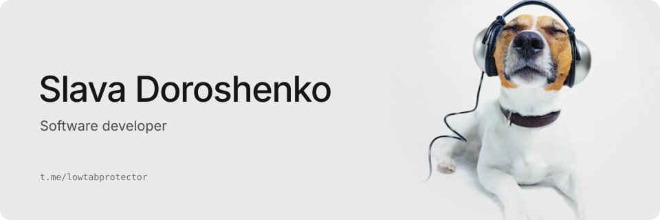

I build web, mobile and desktop interfaces with React, React Native, Capacitor and Astro.

### Selected work

**[perfgate](https://github.com/SlavaDoroshenko/perfgate)**  
Statistical detection of frontend performance regressions in CI. Compares base and PR builds with statistical tests instead of fixed thresholds  
<samp>TypeScript · Python</samp>

**[Ghostfolio](https://github.com/ghostfolio/ghostfolio/pulls?q=is%3Apr+author%3ASlavaDoroshenko+is%3Amerged)**  
Open source wealth management. Moved the analysis and allocations pages to OnPush change detection  
<samp>Angular · 2 merged pull requests</samp>

**[soundcloud-ipod](https://github.com/SlavaDoroshenko/soundcloud-ipod)**  
A SoundCloud client that looks and feels like an iPod Classic: click wheel with haptics, Cover Flow, offline downloads and lock screen controls. One React codebase for iOS and Android  
<samp>React · Capacitor · Swift · Cloudflare Workers</samp>

**[watch-video](https://github.com/SlavaDoroshenko/watch-video)**  
A Claude Code skill that turns bug screen recordings into timestamped contact sheets and a per-frame scroll timeline, so jank and freezes can be found in time  
<samp>Python · ffmpeg · numpy</samp>

### Stack

<samp>TypeScript · React · React Native and Expo · Next.js · Astro · Angular · Tauri · Tailwind · TanStack Query · Playwright · Python · Go</samp>

### Contact

Telegram [@lowtabprotector](https://t.me/lowtabprotector)
